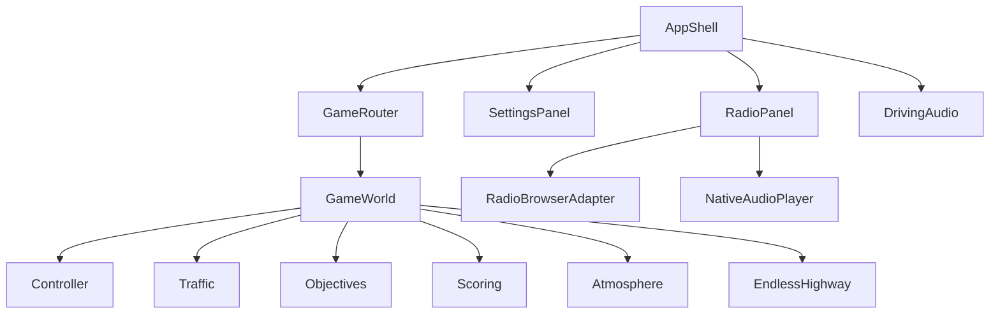

# Runtime architecture

AppShell owns persistent SettingsPanel, RadioPanel and DrivingAudio. GameRouter owns runId-keyed sessions; pause does not remount the simulation. New runs remount once after loading/countdown. Zustand holds low-frequency stats/preferences; R3F refs hold frame-rate state.

Simulation clamps elapsed time to 1/30 to avoid giant catch-up jumps. Distance drives a deterministic road profile. Geometry and vegetation use fixed pools. Traffic collision coordinates remain lane-local; render positions map through roadFrame. Player model pitch/heading and camera lookahead follow the same profile.

Radio owns one HTMLAudioElement and follows media events and play promises. Revision guards prevent stale station-switch promises from changing current state. Connection/buffering watchdogs are bounded; disposal removes listeners and media resources. Favorites, recent stations, imported playlist and preferences persist locally, but playback never resumes automatically after refresh. Radio continues across game pause/restart/menu. Synthetic engine/wind sound is separate and pauses with simulation.

Cross-system changes belong to the lead. Agents own explicit disjoint modules in separate worktrees; reviewed commits integrate serially. See AGENT_TASKS.md for dispatch history.
